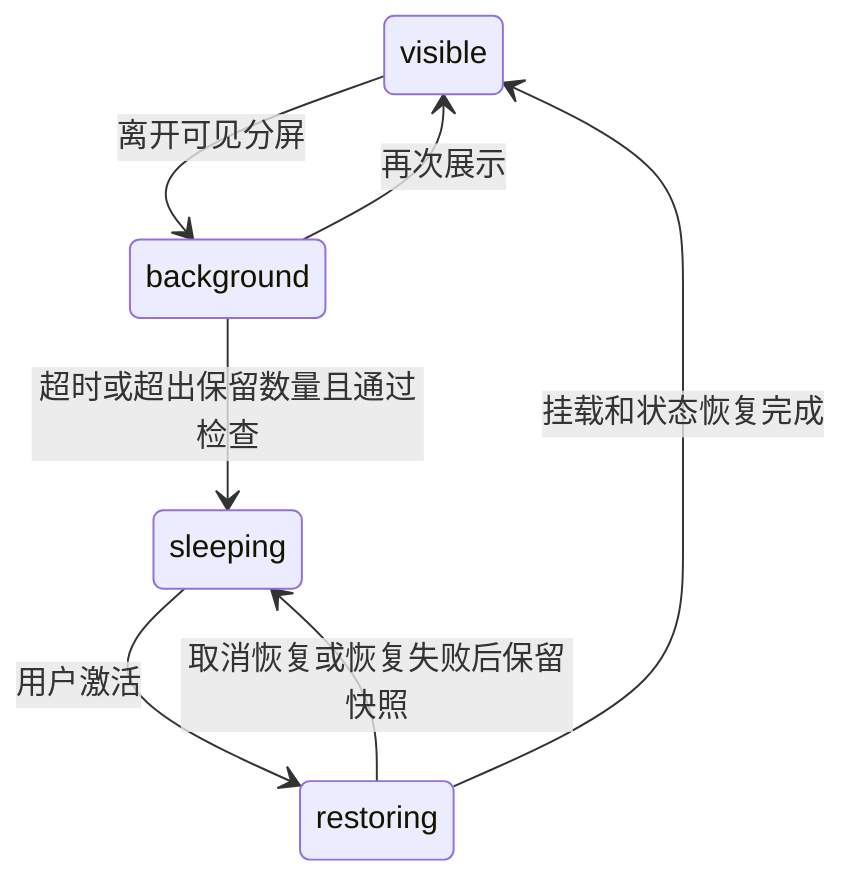

# 工作台标签休眠与内存管理方案

## 2026-11-19 11:15

状态：技术方案草案。策略数值为建议初始值，尚未实施或完成性能测量。

关联方案：[业务组件 JSON 配置方案](./方案设计.md)。

### 1. 目标与实际效果

用户可能打开约 100 个业务标签。长期不用的标签应保留名称、顺序、业务数据和必要的界面状态，同时卸载其 Vue 业务组件及附属资源。重新激活时根据最新业务数据重建界面，提供类似浏览器休眠标签的使用体验。

本方案回收的主要对象包括业务组件实例、DOM、表格渲染缓存、图表实例及组件拥有的订阅、计时器和临时数据。工程 JSON、标签元信息和必要的恢复快照继续保留。

这是应用内部的组件生命周期管理。共享 WebView、已加载的 JavaScript 模块缓存和基础依赖通常仍保留；垃圾回收时机由运行时决定，卸载后进程内存不保证立即下降。实际收益必须测量，不能提前承诺固定回收比例。

### 2. 已核实的代码现状

- `MainContent/useWorkbenchDockview.ts` 创建面板时使用 `renderer: 'always'`。
- `MainContent/WorkbenchEditor.vue` 遍历所有已打开面板，通过 Teleport 挂载 DockviewContent。
- `DockviewContent.vue` 始终挂载 MainContent，未设置休眠边界。
- 工程 JSON 存在 tpStore.rawJson；标签元信息存在 tpStore.tabs。
- 已有业务编辑器通过 `updateItemField` 写回 Store，并维护标签和文件脏标记。

目前打开大量标签可能保留大量后台业务实例。最终内存分布仍需在浏览器和 Tauri 目标环境分别实测。

### 3. 标签状态模型

| 状态 | 业务组件 | 保留内容 | 可以自动休眠 |
| --- | --- | --- | --- |
| visible：可见 | 已挂载 | 完整界面与业务数据 | 否 |
| background：后台待用 | 已挂载 | 完整界面与业务数据 | 通过条件检查后可以 |
| sleeping：已休眠 | 已卸载 | 标签、共享业务数据、必要恢复状态 | 已完成 |
| restoring：恢复中 | 正在挂载 | 原快照和当前最新业务数据 | 否 |

休眠准备失败时继续保持 background，记录具体阻止原因。恢复失败时显示可重试的错误状态，保留快照和标签。



标签关闭属于独立操作，清理该标签所有运行记录和快照，不借助“关闭再打开”实现休眠。

### 4. 默认策略

| 参数 | 建议初始值 | 含义 |
| --- | --- | --- |
| enabled | true，仅适用于已完成适配的业务 | 开启自动休眠 |
| idleTimeoutMs | 600000 | 进入后台 10 分钟后可休眠 |
| maxBackgroundMounted | 10 | 最多保留 10 个可回收的后台业务实例 |
| scanIntervalMs | 30000 | 每 30 秒检查一次后台超时 |
| snapshotBudgetBytes | 65536 | 每个标签的全部恢复状态建议上限 64 KiB |

触发规则：

1. 超过后台闲置时间，满足条件的标签进入休眠。
2. 后台可回收实例超过上限，按最久未使用优先的顺序休眠，直到回到上限。
3. 上述两个条件独立触发；后台实例不足 10 个，也会因长期闲置进入休眠。
4. 可见实例和有保护原因的实例不纳入可回收后台配额；总挂载数可能超过“可见数 + 10”。诊断中应列出受保护实例数量与原因。
5. 重新进入后台时重置闲置起点。时间统计使用单调时钟；窗口恢复可见时立即重新检查，避免依赖后台计时器准点执行。
6. 不使用浏览器专有的堆内存接口作为跨平台自动触发条件，先采用时间和数量策略。

这些值是便于验证的初始策略，可在实测后调整。第一版不必增加完整设置界面。

### 5. 可见性与保护条件

#### 5.1 正确识别可见分屏

不能把“非全局 activeTab”直接视为后台：分屏时，多个分组中的当前面板可能同时可见。

应从 Dockview 的实际分组和面板可见状态计算 visibleTabIds，保护所有实际展示的面板。实施时先核实当前安装的 Dockview 1.17.2 对应的可见性事件与查询接口，不预设不存在的 API。

主区域保留轻量 DockviewContent 外壳，在其中控制业务子树是否挂载；标签 DOM、Teleport 目标节点、Dockview 面板 ID 和分屏结构继续保留。保留现有 `renderer: 'always'` 亦可实现业务子树卸载，不能仅修改该参数便视为完成内存释放。

#### 5.2 暂不允许自动休眠的情况

- 面板实际可见，或正在恢复。
- 业务组件尚未声明并验证休眠能力。
- 存在无法可靠保存的局部业务草稿。
- 正在执行由组件承载且不能中断的测试、提交、导出或上传等任务。
- 某个模块拒绝休眠、快照生成失败或快照超过容量限制。

“固定标签”仅表示不被批量关闭，默认不获得免休眠待遇；确有长期运行需求时通过业务运行时锁保护。

已标记 isDirty 但修改已写回 Store 的标签可以休眠，不自动保存到磁盘，不清除脏标记。是否安全取决于数据是否被可靠保留，而非文件是否已经保存。

### 6. 挂载与数据所有权

```text
Dockview 面板与标签：持续保留
  DockviewContent 轻量外壳：持续保留
    业务子树挂载边界：由标签生命周期控制
      MainContent / ConfiguredModule / 业务组件：休眠时卸载

tpStore 工程业务数据：持续保留
标签恢复快照：按文件会话 + tab + module 保存
```

通过条件渲染真正卸载业务子树。`v-show` 仅隐藏界面；KeepAlive 主要保留实例与状态，二者都不能替代本方案的业务子树卸载。

业务数据只保存一份，不将完整业务项或完整工程复制进每个标签快照。右侧、主区域和多个分屏仍然使用同一个 Store。

### 7. 界面状态与恢复快照

需要保存的典型状态：

- 主内容滚动位置，按 DOM 恢复布局后应用。
- 表格筛选、排序、选中行及分页，使用业务行 ID 标识。
- 分组折叠状态、选中的内部标签、必要的图表视口参数。
- 已完成专门适配的局部草稿；首期优先让可编辑内容及时写入 Store，未适配草稿的组件暂不休眠。

不保存 DOM、Vue 实例、图表实例、函数、监听器、完整接口响应缓存和大规模表格派生结果。这些对象会阻止有效回收，也不适合作为可恢复状态。

```ts
interface TabSnapshot {
  fileSessionId: string
  tabId: string
  capturedAt: number
  mainScroll?: { left: number; top: number }
  groups: Record<string, { collapsed: boolean }>
  modules: Record<string, {
    component: string
    stateVersion: number
    state: JsonValue
  }>
}
```

`JsonValue` 与配置方案保持一致。module key 包含所在区域、组 ID 和模块 ID。快照按序列化后的 UTF-8 字节计算容量；超限时暂缓休眠并提示开发诊断，避免自动丢失状态。

快照仅在当前应用会话内保存，第一版不写入磁盘或 localStorage。状态版本不匹配时保留原快照并报告无法恢复，不直接套用旧状态；无业务草稿的纯 UI 状态可以在明确规则下回退默认值。

关闭标签、切换或重开工程时清理旧快照和运行记录。恢复成功后的当前快照可以被下一次检查点覆盖，不保留无限历史版本。

### 8. 生命周期接口

能力声明放在代码注册元信息中，JSON 只配置启用和超时时间。配置中的 true 不能让尚未适配的组件自动获得可靠休眠能力。

建议提供一个小型 composable，让支持休眠的模块登记以下同步能力：

```ts
interface SuspendParticipant {
  stateVersion: number
  canSuspend: () => { allowed: boolean; reason?: string }
  captureState: () => JsonValue
  restoreState: (state: JsonValue) => void
}
```

- 第一次实施支持同步预检和快照，避免等待异步保存期间的激活竞态。
- 运行中任务通过带 owner 的锁阻止休眠；任务结束或 owner 卸载时释放锁。
- 所有已挂载参与模块先通过预检，再收集并检查全部快照，最后统一卸载主业务子树。
- 任一参与者失败都取消本次休眠；预检和捕获不得偷偷修改业务数据。
- 组件卸载后注销登记函数、锁、事件处理和实例引用，不能让生命周期管理器本身成为泄漏来源。
- 恢复时只恢复界面状态，业务数据始终重新读取 Store 最新值。新产生的数据不能被旧快照覆盖。

如未来支持局部业务草稿恢复，需要记录草稿基线数据版本；发现底层业务数据变化时显式处理冲突。首期不通过通用快照覆盖业务数据。

### 9. 休眠与恢复顺序

休眠：

1. 从实时可见集合排除当前正在展示的面板。
2. 检查能力、任务锁、草稿状态及所有参与者。
3. 捕获滚动与模块状态，校验格式、版本和容量。
4. 再次确认 tab 仍存在、文件会话未变、面板仍不可见。
5. 保存快照并更新状态，使 Vue 卸载业务子树。
6. 执行组件清理，移除管理器持有的所有实例回调引用。

恢复：

1. 用户激活休眠标签，将其标记为 restoring 并立即保护。
2. 保留原 Dockview 面板与分屏位置，挂载业务子树并显示加载状态。
3. 组件读取 Store 最新业务数据，按模块声明的就绪时机应用兼容的 UI 状态。
4. 等待布局稳定后恢复滚动位置，清理已失效的选中行 ID。
5. 完成后标记为 visible；失败保留快照，提供重试入口。

每次恢复使用文件会话和递增请求标识。快速连续切换、关闭标签或打开新工程时，旧恢复结果不得影响新实例。拖拽面板出现的临时移除事件继续沿用现有 Dockview 协调逻辑，不立即当成标签关闭。

### 10. 右侧组件的配合

右侧是当前激活业务的共享展示区域，不为全部后台标签同时挂载右侧组件。

- 业务切换时，保存当前右侧的必要 UI 状态，再切换对应的组和模块；快照按所属 tab 隔离。
- 可编辑右侧模块应及时写回 Store，或者把局部草稿存入有界的界面状态 Store，避免切换即丢失。
- 侧边栏收起时卸载内部模块；展开时按当前 tab 和最新数据重建。
- 切换或收起时若存在无法保留的草稿，必须采用该业务明确的离开处理流程，不能假设组件会自动恢复。
- 后台标签休眠时，其右侧已保存的轻量 UI 状态可保留；其中不应残留右侧组件实例。

右侧参与者的状态管理复用同一套模块 ID 和快照规则，但右侧挂载由当前激活标签和侧栏展开状态控制。

### 11. 资源清理要求

| 资源 | 组件卸载时的要求 |
| --- | --- |
| Vue 作用域内 watcher/computed | 随作用域释放；作用域外创建的监听需显式停止 |
| DOM、window、document 监听器 | 移除绑定 |
| 定时器、动画循环 | clearInterval/clearTimeout/cancelAnimationFrame |
| 图表和表格外部实例 | 调用对应 dispose/destroy，并解除引用 |
| 网络请求 | 取消组件拥有的请求，或通过会话/实例标识丢弃过期回调 |
| ResizeObserver、IntersectionObserver | disconnect |
| WebSocket、事件总线、Redis 订阅 | 释放组件拥有的订阅；共享连接由其服务所有者管理 |
| 第三方缓存和临时数组 | 清理组件拥有的引用与无用缓存 |

持续运行的业务任务应逐步移到独立服务或 Store 中，由界面订阅进度。这样组件休眠不会顺带停止业务任务。第一版遇到仍由组件承载的任务时先加锁保护。

### 12. JSON 中的策略配置

与业务组件配置处于同一业务条目中：

```json
{
  "main": {
    "id": "editor",
    "component": "Continuity"
  },
  "right": [],
  "lifecycle": {
    "suspendEnabled": true,
    "idleTimeoutMs": 600000
  }
}
```

合并优先级为“全局默认 → 业务类型覆盖”。本次不开放每个组任意覆盖整个标签的策略，避免一个标签出现相互矛盾的参数。所有实际参与模块都必须允许休眠；任何模块的任务锁均可阻止该标签回收。

`maxBackgroundMounted`、扫描间隔和快照容量属于全局参数。业务超时时间需校验为正整数并设置合理上下限。

### 13. 模块划分与实施阶段

| 拟新增/修改模块 | 职责 |
| --- | --- |
| `runtime/useWorkbenchTabLifecycle.ts` | 状态转换、闲置时间、候选排序与单个扫描定时器 |
| `runtime/useSuspendParticipant.ts` | 组件登记、预检、捕获、恢复和清理 |
| 小型标签界面状态 Store | 按文件会话和 tab/module 保存有界快照，不引用组件 |
| `useWorkbenchDockview.ts` | 提供实时可见面板集合及激活、移除变化 |
| `WorkbenchEditor.vue` / `DockviewContent.vue` | 保留面板外壳，控制业务子树挂载 |
| `ConfiguredSidebar.vue` | 同步右侧模块的状态保存、切换和卸载 |
| `DockviewTab.vue` | 必要时展示轻量的休眠状态与恢复反馈 |

阶段一：建立真实基线。选取轻量表单、复杂表格、图表业务，记录 100 标签场景的实例数、DOM 数、后台活动及内存趋势。

阶段二：打通最小闭环。先适配 1–2 个业务，完成手动休眠/恢复、滚动状态保留、脏数据保留和分屏保护；诊断入口只供开发验证。

阶段三：接入自动策略。加入 10 分钟超时、后台可回收实例上限 10 个、能力检查、任务锁和失败保护。验证快速切换和窗口重新可见。

阶段四：接入配置与右侧。业务 JSON 控制开关和超时，右侧复用状态管理；完成其他业务的资源清理适配后逐步扩大覆盖。

阶段五：按实测调整。决定是否需要用户设置、手动“休眠其他标签”菜单、不同业务更精细的超时参数。

### 14. 验收与测量

| 场景 | 预期结果 |
| --- | --- |
| 打开 100 个已适配标签，仅一个可见，无任务锁 | 策略执行后，可见业务实例保留，后台可回收实例不超过 10 个，其余进入休眠 |
| 后台只有 3 个标签，均超过超时 | 三个均可进入休眠，不受数量未超限影响 |
| 同时展示左右/上下分屏 | 所有实际可见面板均不休眠 |
| Store 中有未保存业务修改 | 休眠、恢复后修改与脏标记保持；保存文件时内容正确 |
| 存在未适配草稿或运行任务 | 暂缓休眠，明确记录原因 |
| 相同业务类型的两个不同数据项 | 筛选、滚动及模块状态分别恢复，互不串数据 |
| 休眠期间 Store 收到数据更新 | 恢复后显示最新业务数据，旧 UI 快照不覆盖业务值 |
| 快速激活 A、再激活 B、关闭 A | A 的旧请求与恢复回调不会写入 B 或重建已关闭标签 |
| 切换/重开工程，标签 ID 被复用 | 旧工程快照、锁和异步结果全部隔离 |
| 捕获异常、状态版本不兼容或超出容量 | 不静默丢失状态，保留现场或快照并报告原因 |
| 连续休眠/恢复 20 轮 | 实例数、DOM、订阅及计时器不持续累积，恢复后的操作正常 |

测量至少包括业务实例数、DOM 数量、活动计时器/订阅、堆内存趋势、Tauri 进程内存趋势、恢复到可交互的耗时分布和快照总量。开发测试环境可使用堆快照与受控垃圾回收辅助比较，生产逻辑不依赖强制 GC。

性能比较使用相同工程数据、窗口布局和交互步骤。区分首次懒加载与已加载代码后的恢复耗时；先报告基线与改造结果，再设定合理的速度和内存目标。

实施阶段为状态转换、可见性保护、候选排序、快照限制及过期恢复编写行为测试；浏览器回归验证分屏、脏数据和右侧恢复，并在 Tauri 中复测资源释放。另运行现有标签回归测试、Vue 类型检查、相关文件 ESLint 与生产构建。

### 15. 首期边界

- 先支持已验证能够恢复的组件；未适配组件保护运行，不伪装为已经释放。
- 工程原始数据和已加载代码继续常驻，100 个标签的总内存不会因此变为零。
- UI 快照有容量上限；大数据派生结果按需重新生成。
- 应用退出后的标签恢复、崩溃恢复、工程数据分块加载和系统内存压力监听另行设计。
- 当前为方案阶段，默认值与性能收益均需实施后验证。

---
