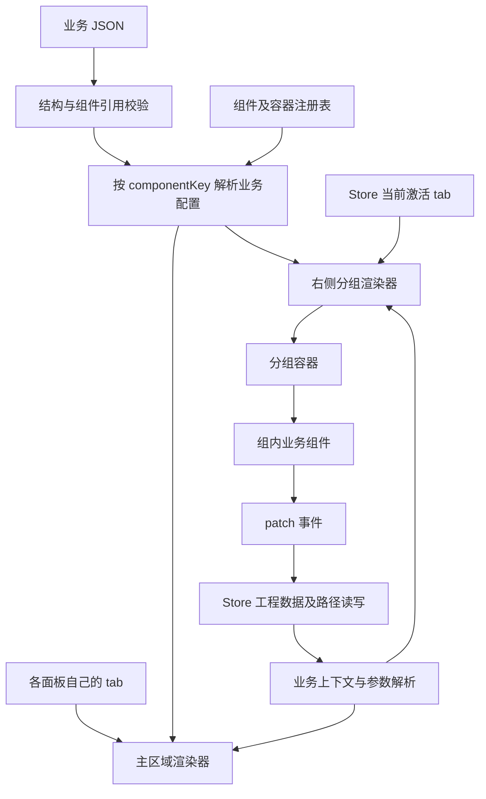

# 工作台业务组件 JSON 配置方案

## 2026-11-19 11:15

状态：技术方案草案。本文用于评审，尚未实施业务代码。

关联需求：[需求理解](./需求理解.md)。关联扩展：[标签休眠与内存管理方案](./工作台标签休眠与内存管理方案.md)。

### 1. 目标与范围

后续预计有 100–200 个业务类型，通过 JSON 管理以下对应关系：

- 业务类型对应的主区域组件。
- 当前业务在右侧辅助侧边栏展示的分组及组内组件。
- 每个分组容器独立的公共配置，例如标题、折叠、边框、间距。
- 每个业务组件独立的静态 props，以及从当前业务数据读取的动态 props。
- 业务类型的标签休眠参数，具体机制见关联方案。

首期配置随应用源码维护、随应用构建发布。组件通过注册名称引用，新增全新 Vue 组件仍需开发和发布代码；已有组件的新组合可以通过配置接入。

字段级表单生成、可视化配置编辑器、远程插件加载、用户任意导入配置、条件表达式语言及任意事件脚本留作后续独立需求。

### 2. 已核实的现有结构

| 文件 | 当前职责 | 改造方向 |
| --- | --- | --- |
| `src/constants/tpRegistry.ts` | 以字符串 key 注册六个异步业务组件 | 保留原 key，增加右侧组件和容器的注册能力 |
| `src/views/workbench/components/basic/MainContent/index.vue` | 根据传入 tab 的 componentKey/dataPath 渲染主组件 | 按业务配置渲染主组件，保留错误边界和 JSON 兜底 |
| `src/views/workbench/components/basic/SecondarySideBar/index.vue` | 右侧空容器、宽度调整、展开与收起 | 接入当前激活业务的分组渲染 |
| `src/views/workbench/components/basic/MainContent/DockviewContent.vue` | 单个分屏面板的业务上下文和内容外壳 | 继续显式传递该面板 tab，并预留休眠挂载边界 |
| `src/store/modules/tp/index.ts` | 工程数据、标签、路径读写、脏标记 | 提供一致的数据更新通知，继续作为业务数据来源 |

参考项目的 `seminar-report-detail/config.ts` 已实现“场景 → 标签 → 模块”的声明式组合，并通过 `dataKey` 取值、`update:data` 回写。该文件直接引用 Vue 组件，属于 TypeScript 配置。本方案使用真正的 JSON，以字符串组件名连接已有 Vue 注册表。

本文中的“分组容器”指右侧业务模块的包裹组件，与 Dockview 的分屏分组分别管理。

### 3. 技术选择

| 类别 | 选择 | 原因 |
| --- | --- | --- |
| 渲染 | Vue 3、Composition API、TypeScript | 沿用现有技术栈 |
| 配置 | 按业务域拆分的标准 JSON | 可阅读、可校验、支持编辑器补全 |
| 注册 | 显式注册表、defineAsyncComponent | 保留懒加载，避免依据任意字符串路径加载代码 |
| 状态 | 现有 Pinia Store + 小型界面状态 Store | 共享业务数据，隔离标签界面状态 |
| 容器 UI | 现有主题变量、Naive UI 与 UnoCSS | 统一标题、折叠、边框和间距 |
| 校验 | JSON Schema + Ajv，补充注册表语义检查 | 结构规则集中维护；Ajv 为拟新增依赖，实施时锁定版本 |

JSON 只声明选择、组合、属性和数据绑定；业务计算、联动及操作由组件和业务逻辑提供。

### 4. 整体结构



主区域始终使用自身传入的 tab；右侧是工作台级共享区域，跟随当前全局激活的 tab。两个可见分屏同时存在时，各自的主区域保持自己的数据，右侧只服务当前激活的一个。

### 5. JSON 示例

建议每个业务域维护一个或多个配置文件，按业务类型汇总为查找表。下面的右侧组件和容器均为拟新增的示例，具体 props 必须与实际组件声明一致。

```json
{
  "$schema": "../schema.json",
  "schemaVersion": 1,
  "business": {
    "Continuity": {
      "main": {
        "id": "editor",
        "component": "Continuity",
        "dataPath": [],
        "props": {}
      },
      "right": [
        {
          "id": "pin-info",
          "container": "PanelGroup",
          "containerProps": {
            "title": "管脚信息",
            "collapsible": true,
            "defaultCollapsed": false,
            "bordered": true,
            "padding": 12,
            "gap": 8
          },
          "components": [
            {
              "id": "pins",
              "component": "PinInfoPanel",
              "dataPath": [],
              "props": {
                "mode": "compact",
                "showChannel": true
              },
              "bindings": {
                "pins": {
                  "source": "item",
                  "path": ["pins"],
                  "fallback": []
                }
              }
            }
          ]
        },
        {
          "id": "test-help",
          "container": "PanelGroup",
          "containerProps": {
            "title": "测试说明",
            "collapsible": false,
            "bordered": false,
            "padding": 8
          },
          "components": [
            {
              "id": "help",
              "component": "TestHelpPanel",
              "props": {
                "topic": "continuity",
                "showExamples": true
              }
            }
          ]
        }
      ],
      "lifecycle": {
        "suspendEnabled": true,
        "idleTimeoutMs": 600000
      }
    },
    "IDDQ": {
      "main": {
        "id": "editor",
        "component": "IDDQ"
      },
      "right": []
    }
  }
}
```

业务查找 key 沿用 `WbTabItem.componentKey`，例如 `Continuity`、`IDDQ`、`PMU_Force`，避免另建一套与适配器不一致的类型名。`main.component` 使用组件注册 key，两者允许不同，因此多个业务类型也可以复用一个主组件。

### 6. 配置结构与传参规则

```ts
type DataPath = Array<string | number>
type JsonValue = string | number | boolean | null | JsonValue[]
  | { [key: string]: JsonValue }

interface PropBinding {
  source: 'item' | 'tab'
  path: DataPath
  fallback?: JsonValue
}

interface ModuleConfig {
  id: string
  component: string
  dataPath?: DataPath
  props?: Record<string, JsonValue>
  bindings?: Record<string, PropBinding>
}

interface GroupConfig {
  id: string
  container?: string
  containerProps?: Record<string, JsonValue>
  components: ModuleConfig[]
}

interface BusinessViewConfig {
  main: ModuleConfig
  right?: GroupConfig[]
  lifecycle?: {
    suspendEnabled?: boolean
    idleTimeoutMs?: number
  }
}
```

以上是运行时核心契约；JSON 文件外层另外包含 `$schema`、`schemaVersion` 和 `business` 字典。

#### 6.1 容器公共配置

第一版提供 `PanelGroup`，负责标题、边框、内边距、模块间距及折叠；普通无标题布局可由同一容器的属性表达。以后需要特殊布局时，再注册对应容器。

- `containerProps` 仅传给容器；`props` 仅传给对应的业务组件。
- 每种容器登记自己的默认配置，合并顺序为“该容器默认值 → 该组 containerProps”。
- 合并采用属性级浅覆盖；数组和对象整体替换，避免隐式深合并。
- 第一版不设置多层继承、模板引用和业务域默认值，减少覆盖规则。
- `padding`、`gap` 以 px 计，校验为合理范围内的非负数，由容器转换为样式。
- `defaultCollapsed` 只决定首次状态；用户后续操作的折叠状态保存在对应 tab/group 的界面状态中。
- 第一版容器展示属性使用静态值；动态标题等能力待实际需求出现后，复用受限的数据绑定机制扩展。

#### 6.2 静态 props 与动态绑定

静态参数放在 `props`，例如显示模式、是否展示某列、帮助主题。动态参数放在 `bindings`，例如当前业务项的管脚列表或标签名称。

- `item` 指当前 tab.dataPath 对应的整个业务项；`tab` 指当前标签的只读元信息。
- `ModuleConfig.dataPath` 相对于业务项；省略或 `[]` 表示整个业务项。
- 组件的实际绝对路径为 `tab.dataPath + module.dataPath`。
- `bindings.path` 相对于所声明的 source。第一版允许 `tab.id/label/componentKey` 等明确登记的元信息，不把整个 Store 暴露给配置。
- 对取值结果为 `undefined` 的绑定使用 fallback；`false`、`0`、空字符串和 `null` 均按原值保留。
- 同名动态绑定覆盖静态 props；组件自身默认值在未传入该参数时生效。
- `data`、`dataPath` 为渲染层保留参数，禁止在 props/bindings 中覆盖；`key`、`ref`、`on*` 也禁止通过配置注入。
- 组件事件由代码中声明的接口连接，JSON 中不保存函数或可执行表达式。

容器和业务组件均应关闭不受控的属性透传，确保拼写错误的参数不会悄悄落到 DOM 上。结构校验只保证值的形状，具体 props 名称和类型还需要组件注册元信息及组件契约检查，不能宣称任意 JSON 已获得完整的 Vue props 类型推导。

### 7. 模块与目录划分

以下路径相对于 `apps/tauri-app/src/views/workbench/`，均为拟新增文件。

```text
config/business/
  schema.json
  test-flow/index.json
  pin-map/index.json
  levels/index.json
runtime/
  types.ts
  registry.ts
  resolve-config.ts
  resolve-props.ts
  validate-config.ts
  useBusinessContext.ts
components/configured/
  ConfiguredModule.vue
  ConfiguredGroup.vue
  ConfiguredSidebar.vue
  containers/PanelGroup.vue
```

| 模块 | 单一职责 | 主要输入/输出 |
| --- | --- | --- |
| 配置加载器 | 汇总 JSON，建立业务 key 索引 | 配置文件 → 已校验配置表 |
| 注册表 | 管理业务组件、容器和能力元信息 | 字符串 key → 稳定的异步组件引用 |
| `useBusinessContext` | 根据显式 tab 派生数据与路径 | tab → 当前业务项、路径、文件会话标识 |
| `resolve-props` | 解析静态参数与路径绑定 | 模块配置 + 上下文 → 组件参数 |
| `ConfiguredModule` | 加载并渲染单个组件，连接错误与 patch | module/context → 组件实例 |
| `ConfiguredGroup` | 合并容器属性，组合组内模块 | group/context → 分组 |
| `ConfiguredSidebar` | 按当前 tab 渲染右侧各组 | tab/config → 右侧内容 |
| `PanelGroup` | 提供公共分组外观和折叠 | 容器属性 + 默认插槽；发出折叠变化事件 |

现有 `MainContent` 和 `SecondarySideBar` 保持为组合入口，避免在其中堆积配置解析和业务计算。配置对象按不可变数据使用；组件引用在模块级登记，避免在 computed 或模板中反复创建异步组件。

### 8. 数据更新与一致性

1. 业务数据统一来自 tpStore.rawJson，不为每个右侧模块复制完整工程。
2. 旧编辑器暂时保留 `data/dataPath + updateItemField` 接口，分批迁移。
3. 新组件通过 `patch` 事件请求更新，载荷为 `{ path: DataPath, value: JsonValue }`。path 为相对于模块 data 的非空字段路径。
4. 渲染器捕获该实例所属 tab、模块绝对路径和文件会话标识，将 patch 转换为 Store 路径更新；禁止在处理旧事件时临时读取全局 activeTab 来决定写入目标。
5. Store 统一维护脏标记。标签切换、组件加载、休眠和恢复本身不产生业务修改。
6. 文件重开或工程替换时递增会话标识，旧组件和异步任务的结果不得写入新会话；已关闭标签的过期操作同样丢弃。

现有 rawJson 使用 shallowRef，而 updateItemField 直接修改嵌套对象。单纯增加动态 props 可能遇到数据已变更、绑定却未更新的问题。实施时需要补齐这一更新链路：建议在路径写入时采用结构共享，替换被修改节点及其祖先的引用，最后替换 rawJson 根引用，让相关参数重新计算。

此方式保留 shallowRef，并避免全工程深拷贝。沿路径复制大型数组仍有成本，需要用真实工程样本验证。旧编辑器中一次操作多次写字段的场景，还要检查即时读值语义；必要时提供批量 patch，避免依赖 Vue props 在同一同步调用栈立即刷新。

第一版动态绑定以读取为主；新增可编辑模块采用统一 patch。自定义“运行测试”“打开详情”等事件后续按实际业务登记处理函数，避免先建立通用事件脚本系统。

### 9. 分屏、右侧切换与空态

- 主区域：使用所属面板 tab；多个分屏互不串数据。
- 右侧：使用 tpStore.activeTab；点击任一分屏使其激活后，右侧切换到该业务。
- 右侧组件 key 至少包含文件会话、tab.id、group.id 和 module.id，切换同类型的不同测试项时也隔离局部状态。
- `right` 缺省或为空时，侧边栏内容显示简短空态，保留用户当前宽度和展开偏好，不自动改全局布局开关。
- 设置页及没有业务上下文的标签不生成业务右侧内容。
- 侧边栏收起时卸载内部业务子树；需要保留的 UI 状态由界面状态 Store 保存，展开时读取当前激活 tab 及最新数据。
- 异步组件采用明确的加载与失败状态，快速切换时避免旧结果显示在新标签中。

### 10. 配置校验与降级

配置加载时执行一次校验，构建检查覆盖全部业务配置。JSON Schema 负责结构校验；注册表负责组件/容器存在性和参数契约检查。

| 问题 | 处理 |
| --- | --- |
| 未支持的 schemaVersion、结构不合法 | 构建检查失败；运行时隔离该业务配置 |
| 跨文件业务 key 重复 | 报错，禁止按文件顺序悄悄覆盖 |
| 组 ID 重复、同组模块 ID 重复 | 报错，并给出配置文件及字段路径 |
| 容器名未知 | 该组展示配置错误，其余组继续运行 |
| 右侧组件名未知、组件加载失败或渲染异常 | 模块级错误提示，其他模块继续运行 |
| 动态数据路径不存在 | 使用 fallback；未声明 fallback 时传 undefined，由组件空态处理 |
| 主业务没有配置 | 迁移期回退现有 TP_COMPONENTS 注册；仍未知时展示 FallbackJsonView |
| 主业务配置损坏 | 给出配置错误；允许通过既有注册组件或 JSON 兜底查看业务数据 |

所有动态 key 查找使用 Map 或自有属性检查。数据路径只访问已有的自有属性，拒绝原型相关路径段。诊断包含业务 key、group/module ID、文件名、tab ID 与数据路径；复用已有 ComponentErrorBoundary 并扩展必要的配置定位信息。

### 11. 实施顺序

1. 建立 JSON 契约、Schema、校验器和注册表；维持现有六个组件 key。
2. 补齐路径更新通知与数据绑定规则，验证旧编辑器的多字段联动。
3. 实现通用模块、分组、PanelGroup；先用 Continuity 和 IDDQ 验证不同右侧组合。
4. MainContent 接入主组件配置，SecondarySideBar 接入激活 tab 的分组配置。
5. 验证分屏、同类型不同数据项、错误隔离、折叠状态和保存链路。
6. 接入独立的标签休眠方案；仅对已完成生命周期适配的业务启用自动休眠。
7. 按业务域逐步迁移其余配置，保留可撤回的旧注册渲染路径。

### 12. 验收与验证

- 两种业务切换后，主组件和右侧分组与各自配置一致。
- 同一容器在不同组的标题、边框、折叠及间距互不影响。
- 同一组件能在多个模块中接收不同 props；动态绑定保留 false/0/null。
- 修改主区域后，右侧绑定及时更新；右侧 patch 正确写回对应数据项并标记未保存。
- 两个可见分屏保持各自业务数据，右侧始终对应当前激活面板。
- 组件异常和配置错误局部隔离；原始 JSON 兜底可用。
- 仅解析全部配置不会提前加载所有业务组件代码；新增已有组件组合只需修改 JSON。
- 为配置解析、参数覆盖、路径写入和跨标签事件归属编写行为测试；使用真实页面验证分屏及右侧交互。
- 实施阶段运行相关测试、`pnpm --filter @apps/tauri-app typecheck`、相关文件 ESLint 和生产构建。

### 13. 已选择的边界与风险

- 配置随应用发布；磁盘热更新与远程配置另行设计。
- 第一版使用静态容器属性、静态 props 和受限路径绑定；复杂业务逻辑放入组件。
- props 类型检查需要登记组件契约，单靠 JSON Schema 无法自动推导所有 Vue 组件参数。
- 右侧跟随一个全局激活标签；每个分屏独立右侧面板属于另一种布局需求。
- 休眠会影响组件局部状态，生命周期能力与配置渲染分层实现，详见关联文档。

---


## 2026-11-21 15:09

### 工业工作台 UI 规范精简

采用 [UI设计规范](./UI设计规范.md) 约束文字层级、间距、控件与表格尺寸、交互状态。主题继续由原 Store 管理，字号与高度复用 typography.ts 和现有 UnoCSS 工具类。仅在出现实际重复且现有能力无法覆盖时提取共享值。

按用户要求撤回之前的重复变量层、独立配色、密度机制和预览，以及对应旧版记录。恢复 Dockview 对原主题变量的直接引用，保留并行的分隔条交互修改。应用 AGENTS 只保留简短入口，不增加运行时代码、依赖或配置生成器。本次不全量改造旧组件。

---


## 2026-11-21 22:15

### Proxima 测试程序启动与 Load 流程

- 工作台入口保留 `/workbench`。没有加载成功的工程时展示 `ProjectHome`；成功后切换为现有 `WorkbenchBasic`，不恢复上次文件、不自动载入样例。
- `ProjectHome`：复用标题栏、Logo 和主题，呈现参考首页的四个入口及真实最近工程；接收 busy/recentProjects，发出 open/openRecent。当前仅 Open Project 接入，其他入口明确禁用。
- `ProjectLoadDialog`：接收加载状态，展示程序名、路径、模拟进度、错误；发出 cancel/retry。
- `project-file.ts`：Tauri 原生单文件选择器与浏览器预览适配，均限制 .prx，读取前再次校验后缀。
- `project-loader.ts`：解析 JSON、校验根对象、生成导航树。tp Store 统一管理加载状态与取消，在所有步骤成功后一次性替换当前工程；重复点击受控，取消后的旧读取结果无效。
- 继续使用现有测试流、管脚和电平适配器；通用 JSON 字段使用 `ProjectDataView` 展示，包括 false、0、null。
- 提供的 Prox.prx 是 5 字段工程清单，导航树按文件本身生成。本阶段不读取 DefFileFolder/configFile 指向的外部文件，不执行真实硬件加载。

---


## 2026-11-21 23:00

### PRX 多文件工程与 ATE 导航树

1. 原生增加 read_project_bundle IPC：以选择的 .prx 为入口，只读取工程根目录内的 configFile 和 DefFileFolder/**/*.json，返回各文件的相对路径和文本及缺失波形引用。路径解析拒绝越界；必需文件缺失或无效则整体失败。
2. 前端独立 project-bundle 模块解析清单、硬件配置与定义文件，生成以 DUT / Tester / Test Conditions / Job 为根的业务树。按 DefFileType 路由，保留未知类型并给出提示。
3. records 与 subslotModules 按 slot/subSlot 关联；子槽位数量严格按 subslots 校验，未安装位置生成 FILLER，MIO16 附带 PPMU。硬件节点既能展开也能打开详情；分类仅展开。
4. ProjectDefinitionView 接收 data/dataPath，按定义类型展示可横向滚动的数据表（pinmap 两表、joblist 作业表、其余 data 表）；ProjectHardwareView 展示模块字段与来源；表格均只读，保留原始字段值。PatternTool 未配置则禁用并说明，缺失 .pat 仅提示，不伪造内容。
5. 内存聚合数据保留 documents 来源映射；保存仅按来源写回 JSON，不允许聚合对象覆盖 .prx。新工程确认成功前不替换旧工程。
6. 桌面仍只选择 .prx；浏览器不具有相邻文件访问权限，提供明确的工程目录选择作为预览入口。
7. 增加解析、来源保存、路径边界与界面交互测试；实际 93k 工程应显示 10 个定义文件、4 个主槽位、8 个 FILLER、2 个 PPMU。

组件边界：ProjectHome 负责打开入口；ProjectLoadDialog 展示加载反馈；project-bundle 负责纯数据校验和树生成；project-file 负责平台文件读取；tp Store 负责会话提交/取消与数据来源；ProjectDefinitionView/ProjectHardwareView 负责只读展示，DefinitionTable 负责表格渲染。

---

## 2026-11-22 00:43

### Pin Table 表格编辑

PinTableEditor: 组合搜索栏和 NDataTable，复用 useNaiveTable 列与滚动宽度能力，显示截图五列。
usePinTable: 合并两组 JSON 行并保存来源路径，管理搜索、选中及通过 Store 写回；保持 metadata 和未展示字段。
PinTableCell: 接收 value/label/options，点击或键盘激活编辑，Enter/失焦提交、Esc 取消，通过 update 事件通知父组件。
工程解析器: pinmap 定义映射到 PinTable + content 路径，确保实际菜单打开新编辑器。
验证: 真实 93k 文件、四列编辑、按列搜索、原始数组映射、取消与未保存状态、写回源文件及明暗主题。

---


## 2026-11-22：Pin Table 右键插列

- 复用 NDataTable、useNaiveTable、useTableOperate、TableHeaderOperation，支持搜索、新增行、单条和批量删除、全选、刷新和列设置。
- BusinessColumnHeader 仅负责右键菜单和直接命名，通过 insert/rename/finish/select 事件通知业务表格；useBusinessTableColumns 负责功能开关、唯一字段键及插入位置。
- 用户选择右键表头左/右插入，插入后直接命名；不再使用新增列弹窗。列默认文本类型和空值，Enter/失焦确认，Esc 保留默认名；自定义列允许后续重命名。
- usePinTable 按原始数组路径编辑和删除，通过 Store 写入 metadata.tableColumns 与行字段；支持空表、保存重载和未保存标记，保留既有字段。
- 普通单元格更新不重建列；列设置中的拖拽顺序在编辑及重命名后保留，新增列依照当前顺序插入并持久化最终顺序。列设置名称保持纯文本，避免重复挂载表头编辑器。
- 配置入口为 TP_TABLE_CONFIGS，allowAddColumn 默认 false；仅 Pin Table 显式开启。ATE 消费端兼容性需后续根据实际 schema 对接验证。


## 2026-11-22 23:04

### 文件数据的全局状态管理建议（讨论方案，未实施）

建议继续以现有 Pinia useTpStore 管理当前工程的共享数据。判断依据是数据是否跨组件读取、编辑，以及是否需要统一保存，而不是数据是否来自文件。现有 commitProject 已将解析后的工程写入 rawJson，并记录 projectDocuments 来源映射，无需新增第二份工程 Store。

职责划分：services/project-file 和文件 IPC 负责选择、读取与写入；core/project-loader、project-bundle 负责解析、校验与构建工程；useTpStore 负责工程数据、统一写入入口、修改标记和保存协调；组件负责展示和局部交互。

状态归属：工程配置、管脚定义、规格参数等跨面板业务数据放在工程 Store；文件路径、加载状态和未保存标记继续在工程 Store 管理；搜索文字、菜单开关、尚未提交的输入草稿保留在组件；筛选结果和统计值由 computed 派生，避免维护重复的可写副本。局部草稿提交后通过 action 更新工程。

关键约束：rawJson 当前使用 shallowRef，updateItemField 原地修改深层字段不会自动触发 rawJson 的响应式通知。PinTableEditor 已通过 $onAction 和局部 revision 刷新，但不能据此认定其他消费者都会同步。后续应统一封装更新订阅与数据选择逻辑；可先采用共享响应式 revision，并确保消费端派生数据显式依赖该版本，遇到父子组件复用相同对象引用时也要传递更新信号。若实测全局刷新成本过高，再按文档或数据路径划分版本。暂不为此复制整个工程或直接将全部数据改为深度响应式。

所有已提交业务修改通过 Store action 执行，由 action 负责校验、修改记录和更新通知；Pinia 本身不会禁止直接改对象，需要保持统一写入约定。共享状态的视图更新与业务引用联动应分别处理：例如管脚改名后，其他模块保存的名称字符串不会自动改名，需按实际引用模型设计专用操作。

保存继续使用现有 saveFile 和 projectDocuments 路径映射，将修改写回各自源文件。Pinia 是内存状态，不等于文件持久化。下一步优先完善共享更新机制；验证同一字段在两个面板同步、派生数据刷新、草稿取消、保存重载和切换工程重置。当前仅记录方案，不修改业务代码。

---
